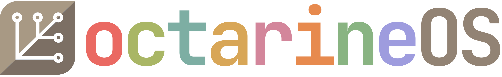

<p align="center"><picture><source media="(prefers-color-scheme: dark)" srcset="system_files/usr/share/octarine-os/logo/octarine-logo-dark-512.png"><source media="(prefers-color-scheme: light)" srcset="system_files/usr/share/octarine-os/logo/octarine-logo-light-512.png"></picture></p>

# octarineOS

A personal [bootc](https://github.com/bootc-dev/bootc) image: Fedora Silverblue on top of Universal Blue's
`silverblue-main`, with the niri compositor and Noctalia shell, libvirt, Cockpit, backup tools and a set of
hardening and tuning defaults. It is built daily and signed.
It makes one desktop reproducible and is shared in case parts of it are useful to you. It is one person's
configuration with no promises: read what it changes (the lists below) before you run it. The wider desktop setup is in
[`CONFIG-GUIDE.md`](CONFIG-GUIDE.md).

## Requirements

- A PC that runs Fedora Silverblue (the current release), with UEFI boot and enough disk for the image.
- An internet connection for the install and for updates.

## What it adds to Fedora Silverblue

From the Universal Blue base (`ghcr.io/ublue-os/silverblue-main`), not added here: distrobox, ffmpeg and the
multimedia codecs, security-key support, `ujust` and its recipes, and automatic update staging.

Added by this image:

**Desktop and apps**
- niri compositor and Noctalia shell (optional)
- zsh as the login shell for new users
- Backup tools: snapper, btrfs-assistant, borgbackup, restic, rclone
- Virtualization: libvirt, qemu-kvm, libguestfs and virt-v2v
- Cockpit and its host modules (off by default)
- PCP metrics
- Tailscale and `usbip` (off by default)
- Podman extras: podman-compose, podman-tui, podman-docker, kind; rootless Podman socket on for every user
- steam-devices, GSConnect, GameMode config, a Proton environment snippet
- Flatpak apps preinstalled: GNOME apps, Firefox, Thunderbird, virt-manager, Vorta, Flatseal, Bazaar

**Removed from the base**
- gnome-software (Bazaar is the software center; firmware updates still work)
- The Firefox RPM (the Flatpak replaces it) and `toolbox`
- Compilers and build tools stay out of the host; they live in the toolbox

**Homebrew**
- Installed on first boot; formulae update automatically, upgrades are manual

**Toolboxes**
- `ujust toolbox dev-toolbox` and `ujust toolbox gaming`
- Optional IDE launchers and exported build tools

**Hardening and defaults**
- sshd (off by default): no root login, no X11 or TCP forwarding; password and keyboard-interactive logins are not turned off
- Kernel and network tuning: ptrace scope, restricted kernel pointers, SysRq, BBR, a higher `vm.max_map_count`, zram swap tuning, `iommu=pt`
- Firewall zone with named services (Sunshine, MoonDeckBuddy, Steam streaming, GSConnect, Tailscale)
- Security-key (YubiKey) touch for sudo and polkit, see below; 30-minute sudo timeout
- Images are signed; `bootc upgrade` refuses unsigned ones after step 3 below

## Use it

1. Install Fedora Silverblue (the current release, 45).
2. Switch to the image (this is the first install of it), then reboot:

   ```
   sudo bootc switch ghcr.io/redcodeworks/octarine-os:latest
   ```

3. Switch again so updates are signature-verified, then reboot:

   ```
   sudo bootc switch --enforce-container-sigpolicy ghcr.io/redcodeworks/octarine-os:latest
   ```

4. Install the preinstalled apps (run it from the desktop, in a terminal):

   ```
   ujust flatpak-preinstall
   ```

5. Optionally run the user setup, a checklist that asks before each step (groups, zsh login shell, Flatpak access, Nerd Fonts, a fish terminal profile with the starship prompt, GNOME search providers):

   ```
   ujust user-setup
   ```

Pin a dated build, try the unreleased one, or roll back:

```
sudo bootc switch --enforce-container-sigpolicy ghcr.io/redcodeworks/octarine-os:latest-<date>-<sha>   # pin (tags are on the package page)
sudo bootc switch --enforce-container-sigpolicy ghcr.io/redcodeworks/octarine-os:testing               # unreleased build
sudo bootc rollback                                                                                    # boot the previous deployment
```

## Beta channel

A weekly build on top of Universal Blue's beta base is published as `ghcr.io/redcodeworks/octarine-os:beta`. It shows early whether a coming Fedora
release would break the image; until Universal Blue starts a new beta it is the same Fedora release as `latest`. It has not been tested for daily use.
Try it, and go back:

```
sudo bootc switch --enforce-container-sigpolicy ghcr.io/redcodeworks/octarine-os:beta
sudo bootc switch --enforce-container-sigpolicy ghcr.io/redcodeworks/octarine-os:latest   # undo
```

## NVIDIA graphics

A variant with the proprietary NVIDIA driver is built weekly as `ghcr.io/redcodeworks/octarine-os-nvidia`. Run the steps above first, then
`sudo bootc switch --enforce-container-sigpolicy ghcr.io/redcodeworks/octarine-os-nvidia:latest` and reboot. With Secure Boot on, enroll the key with
`ujust enroll-secure-boot-key`. It is for NVIDIA GPUs only and is not supported by the owner, who does not use it.

## Security key (YubiKey) for sudo and polkit

With a security key enrolled, sudo and polkit password prompts accept a touch of the key instead of the password, in interactive sessions. Without an enrolled key the password works as usual.

Enroll a key:

```
mkdir -p ~/.config/Yubico
pamu2fcfg -o pam://sudo -i pam://sudo > ~/.config/Yubico/u2f_keys
```

Touch the key when it blinks. To add a second (backup) key to the same line:

```
f=~/.config/Yubico/u2f_keys
{ tr -d '\n' < "$f"; pamu2fcfg -o pam://sudo -i pam://sudo -n | tr -d '\n'; echo; } > "$f.new" && mv "$f.new" "$f"
```

Check: `sudo -k` then `sudo true` asks for the touch. To undo, delete `~/.config/Yubico/u2f_keys`.

## Recipes

`ujust --list` shows them all.

| Recipe | What it does |
|---|---|
| `ujust flatpak-preinstall` | Installs the Flatpak apps the image lists (`--dry-run` shows them); run it from a desktop terminal, safe to repeat |
| `ujust user-setup` | Step-by-step checklist for a new user (see above; with `gum` installed it opens a proper checklist menu); `--yes` takes the defaults, `--no` only prints the plan, `--only STEP[,STEP]` runs named steps |
| `ujust gaming-setup` | Step-by-step checklist for gaming: Steam, ProtonUp-Qt and Lutris from Flathub (verified apps only), gamescope, MangoHud and Proton-GE for Steam, an experimental extest build, generated Steam launchers (including a gamescope one at your screen's resolution), and the GameMode tuning; `ujust gaming-setup reset` undoes it |
| `ujust toolbox [<name>]` | List the toolboxes, or create and manage one (`ujust toolbox dev-toolbox`, `ujust toolbox gaming`); `--help` shows the options |
| `ujust gnome-candy <recipe>` | Themes and icons from [gnome-themes](https://github.com/redcodeworks/gnome-themes), installed into your home directory |

## Contributing

This is a personal image; see `AGENTS.md`. `main` is protected: work happens on `testing` and a pull request
promotes it. Maintainer notes (design, CI, base image upgrades, forking, logo files) are in `CLAUDE.md`.

## License

Apache-2.0, inherited from the [Universal Blue image template](https://github.com/ublue-os/image-template).
See `LICENSE`.

## Credits

The logo is a recolored version of the Fedora Silverblue logo; Fedora and the Fedora logo are trademarks of Red Hat, Inc.
The wordmark is set in JetBrains Mono (SIL OFL 1.1, © The JetBrains Mono Project Authors).

The experimental extest option of `ujust gaming-setup` builds [extest](https://github.com/Supreeeme/extest) by Supreeeme
and contributors (MIT license) from a pinned upstream commit; this repo ships none of its source.

This image builds on [Universal Blue](https://universal-blue.org)'s `silverblue-main` base, its Homebrew files image and its image template (the template is Apache-2.0). The firewall service definition for GSConnect is from the GSConnect developers (GPL-2.0-or-later, noted in the file).

## About this repo

This is a personal project, assisted by Claude (Anthropic's coding assistant), so please excuse the slop.
I have only tested it on my own machine and will not actively maintain it beyond my own needs.

### Fork it

If you find something valuable here, you are encouraged to fork it: change the image name and organization,
generate your own signing key, and adjust the package list and files under `system_files/` to your taste. The
steps are in `CLAUDE.md`.
