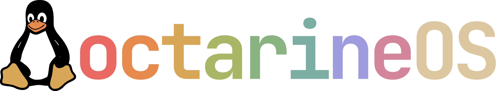

<p align="center"></p>

# octarine-os

A personal [bootc](https://github.com/bootc-dev/bootc) image: Fedora Silverblue on top of Universal Blue's
`silverblue-main`, with the niri compositor and Noctalia shell, libvirt, Cockpit, backup tools and a set of
hardening and tuning defaults. It is built daily and signed with [cosign](https://github.com/sigstore/cosign).
It makes one desktop reproducible and is shared in case parts of it are useful to you. It is one person's
configuration with no promises: read what it changes (below) before you run it. The wider desktop setup is in
[`CONFIG-GUIDE.md`](CONFIG-GUIDE.md).

## What it adds to Fedora Silverblue

From the Universal Blue base (`ghcr.io/ublue-os/silverblue-main`), not added here: distrobox, ffmpeg and the
negativo17 multimedia stack, pam-u2f, `ujust` and its recipe framework, and automatic update staging.

Added by this image:

**Desktop and packages** (`build_files/build.sh`)
- niri compositor and Noctalia shell (optional)
- Packages in two tiers: critical (build fails, vendor checked in CI) and optional (CI warning when missing)
- zsh as the login shell for new users
- Backup tools: snapper, btrfs-assistant, borgbackup, restic, rclone
- Virtualisation: libvirt, qemu-kvm, libguestfs and virt-v2v
- Cockpit and its host modules (socket off by default)
- PCP metrics (`pmcd` and `pmlogger` on)
- Tailscale and `usbip` (services off by default)
- ROCm (HIP, OpenCL, `rocm-smi`), optional
- Podman extras: podman-compose, podman-tui, podman-docker, kind; rootless Podman socket on for every user
- steam-devices, GSConnect, GameMode config (`system_files/etc/gamemode.ini`), a Proton environment snippet
- Flatpak preinstall lists (GNOME apps, Firefox, Thunderbird, virt-manager, Vorta, Flatseal, Bazaar)

**Removed from the base** (`build.sh`)
- gnome-software (Bazaar is the software centre; fwupd and PackageKit stay)
- The Firefox RPM (the Flatpak replaces it) and `toolbox`
- Compilers and build tools stay out of the host; they live in the toolbox

**Homebrew** (`Containerfile`, `build.yml`)
- Files from Universal Blue's brew image, pinned to a dated tag and cosign-verified in CI
- Prefix is created on first boot; update timer on, upgrade timer off

**Toolboxes** (`system_files/usr/share/ublue-os/distrobox/`)
- `ujust toolbox dev-toolbox` and `ujust toolbox gaming`, built from separate images (`fedora-toolbox`, `fedora-gaming`)
- Optional IDE launchers and exported build tools

**Branding** (`build.sh`, `system_files`)
- `PRETTY_NAME` is `octarineOS`; ID, NAME and VERSION_ID are unchanged
- Tux wordmark logo on the GDM login screen and the Plymouth boot screen (own `octarine` theme, initramfs rebuilt)

**Hardening and defaults** (`system_files`)
- sshd: no root login, no X11 or TCP forwarding
- sysctl: ptrace scope, `kptr_restrict`, SysRq, BBR, inotify limits, a higher `vm.max_map_count`, zram swap tuning
- firewalld zone with named services (Sunshine, MoonDeckBuddy, Steam streaming, GSConnect, Tailscale port)
- pam-u2f for sudo and polkit, 30-minute sudo timeout, a higher memlock limit for `wheel`, kernel argument `iommu=pt`
- Container signature policy for this image's own registry path, so `bootc upgrade` rejects unsigned images
- Build guard that refuses security-key registrations and private keys in `system_files`

**Supply chain and CI** (`.github/workflows/build.yml`)
- Daily build; images signed with cosign
- Build once, promote: a merge to `main` retags the tested, signed `testing` image when its content matches
- `testing` channel; `main` is protected and changes by pull request
- Base image and Fedora release come from the variables `BASE_IMAGE` and `FEDORA_VERSION`; the build logs the resolved base digest
- A newer push to `testing` cancels the older build; docs-only changes skip the heavy build
- Smoke test of the image before it is pushed

**`ujust` recipes** (`system_files/usr/share/ublue-os/just/60-custom.just`)
- `add-user-groups`, `toolbox`, `gnome-themes` (themes and icons live in their own repo), Flatpak helpers for games, Steam, VS Code, Podman Desktop, Chrome web apps and Gear Lever; the full list is under "Recipes"

## Use it

```
sudo bootc switch ghcr.io/redcodeworks/octarine-os:latest
```

Reboot, then run `ujust add-user-groups` to join the `gamemode`, `input` and `libvirt` groups.

To verify the signature yourself:

```
cosign verify --key cosign.pub ghcr.io/redcodeworks/octarine-os:latest
```

The image also installs a container signature policy for its registry path, so `bootc upgrade` rejects an
unsigned or wrongly signed image.

Pin a dated build, try the unreleased one, or roll back:

```
sudo bootc switch ghcr.io/redcodeworks/octarine-os:latest-<date>-<sha>   # pin (tags are on the package page)
sudo bootc switch ghcr.io/redcodeworks/octarine-os:testing               # unreleased build
sudo bootc rollback                                                      # boot the previous deployment
```

## Base image

The base is `${BASE_IMAGE}:${FEDORA_VERSION}`, default `ghcr.io/ublue-os/silverblue-main:45`. The defaults are in
the workflow `env:` block (`.github/workflows/build.yml`) and repeated as `ARG` defaults in the `Containerfile`
(keep them in sync); the repository variables `BASE_IMAGE` and `FEDORA_VERSION` override the workflow defaults.
CI and `just build` pass both values as build args; for a local experiment `FEDORA_VERSION=46 just build` works.
Fedora major upgrade:

1. Set the variable: `gh variable set FEDORA_VERSION --body 46 -R <owner>/<image>` (undo: `gh variable delete
   FEDORA_VERSION`), or edit the default in the workflow `env:` block and the `Containerfile` ARG on a commit.
2. Changing a variable does not start a build: run the `Build container image` workflow on `testing` (a push to
   `testing` or manual dispatch). The "Check the base image can be pulled" step fails early and names the tag if
   it does not exist (`skopeo list-tags docker://ghcr.io/ublue-os/silverblue-main` lists them); the smoke test
   checks that `VERSION_ID` matches. The log and the OCI labels `org.opencontainers.image.base.name` and
   `base.digest` record the resolved base.
3. Test the `testing` build: `sudo bootc switch ghcr.io/<owner>/<image>:testing` (or the testing VM).
4. Soak about a week and keep the current deployment pinned as the rollback (`sudo ostree admin pin <index>`).
   Then merge the pull request: promotion only retags an already tested `testing` digest, so a variable changed
   without a tested `testing` build never reaches `latest` by promotion; the daily scheduled `main` build does
   read the variable, so set it only when you intend the next scheduled build to use it.

## Recipes

`ujust --list` shows them all.

| Recipe | What it does |
|---|---|
| `ujust add-user-groups` | Add a user to the `gamemode`, `input` and `libvirt` groups |
| `ujust toolbox [<name> [options]]` | List the toolboxes, or create and manage one (`ujust toolbox dev-toolbox`, `ujust toolbox gaming`); `ujust toolbox <name> --help` shows the options; `--ide` makes IDE launchers (JetBrains icon: the one Toolbox registered, else the file in the app's `bin/`; rerunning refreshes the icon of launchers it created) |
| `ujust gnome-themes <recipe>` | Run a recipe of [gnome-themes](https://github.com/redcodeworks/gnome-themes): themes and icons live there, not in the image |
| `ujust flatpak-games-access` | Give the Flatpak game launchers access to a games directory |
| `ujust steam-flatpak-devices` | Let Flatpak Steam see USB and input devices |
| `ujust steam-gamescope-setup` / `-reset` | Make Flatpak Steam and the gamescope layer work together, or undo it |
| `ujust extest-build`, `extest-steam-setup`, `extest-steam-reset` | Experimental: extest for Steam Input on Wayland |
| `ujust vscode-flatpak-podman` | Let Flatpak VS Code use Wayland and the rootless Podman socket |
| `ujust podman-desktop-deny-docker-socket` | Keep Podman Desktop away from a Docker socket |
| `ujust chrome-flatpak-webapps` | Let Flatpak Chrome install web apps as launchers |
| `ujust gearlever-applications` | Let Gear Lever manage AppImages in `~/Applications` |

## Personal choices worth reviewing

These ship to everyone who uses the image as-is:

- **PAM:** `pam_u2f sufficient` for sudo and polkit. With a security key enrolled, a touch alone gives root;
  without a key the password still works. That is weaker than stock Fedora.
- **Firewall:** the default zone allows named services for Sunshine, MoonDeckBuddy, Steam streaming,
  GSConnect and Tailscale's UDP port.
- **sysctl:** `vm.overcommit_memory=1`, `kptr_restrict`, `ptrace_scope`, a very high `vm.max_map_count`, SysRq enabled.
- **Kernel argument:** `iommu=pt`.
- **Size:** ROCm makes the image big (roughly 11 GB on disk). It carries no compilers; those live in the toolbox.
- **Services:** only `pmcd`, `pmlogger` and `flatpak-preinstall` are enabled; `sshd`, `tailscaled`,
  `cockpit.socket` and the snapper timers are installed and left off.
- **Homebrew:** the files of Universal Blue's `ghcr.io/ublue-os/brew` image (pinned to a dated tag, signature
  checked in CI). On first boot `brew-setup.service`
  extracts the prefix for UID 1000, unless a prefix already exists; `brew-update.timer` is enabled and
  `brew-upgrade.timer` is kept off (upgrades are manual). Formulae are not pinned (use `brew bundle`). Details in `CONFIG-GUIDE.md`.
- **Packages in two tiers:** `build.sh` installs a short CRITICAL list in one transaction (the build fails when
  one is missing, and CI checks that each has the RPM vendor `Fedora Project`) and everything else as OPTIONAL
  groups (a failed group is retried package by package; what still cannot be installed is listed in
  `/usr/share/octarine-os/optional-packages-missing` and shown as a CI warning, and the build goes on). Packages from
  outside Fedora's own repositories (negativo17 codecs, RPM Fusion, COPR) may only be optional. `fish` is optional: nothing in the image depends on it and it is never a login shell (bash stays the login shell; new users get zsh). A user who configures their own terminal to start fish needs it installed, which is their own setting.
- **Login shell for new users:** `zsh` (`SHELL=/usr/bin/zsh` in `/etc/default/useradd`, plus `/etc/skel/.zshrc`).
  Existing accounts and root keep their shell. Risks: rolling back to an image without zsh breaks only accounts
  created while zsh was the default; distrobox copies the host login shell, so every toolbox image a zsh user
  enters needs zsh (`dev-toolbox` has it; check the `gaming` one).
- **Flatpaks:** a preinstall list of apps. Themes and icons are not in the image.

## Contributing

This is a personal image; see `AGENTS.md`. `main` is protected: work happens on `testing`, a pull request
promotes it, and CI is the test. A newer push to `testing` cancels the older pending or running build
(never on `main` or the scheduled run); a cancelled build can leave the `testing` tag unsigned until the next build finishes. Maintainer notes (design, CI, forking) are in `CLAUDE.md`.

## License

Apache-2.0, inherited from the [Universal Blue image template](https://github.com/ublue-os/image-template).
See `LICENSE`.

## Credits

The logo (GDM login screen and Plymouth boot screen) is Kevin's own artwork: a wordmark combined with Tux. The Tux
part is derived from
[Linux_mascot_tux.png](https://commons.wikimedia.org/wiki/File:Linux_mascot_tux.png) on Wikimedia Commons,
[CC0](http://creativecommons.org/publicdomain/zero/1.0/deed.en) by OpenClipart-Vectors from Pixabay, based on Tux
by Larry Ewing and The GIMP (credit is a courtesy, not required).

The full-size file (`octarine-logo-full.png`, 7000x1280) is the source for every smaller size: resize it with Lanczos and
keep the alpha channel. The original uncompressed artwork is not stored in the repo or the image because it is about 30 MB.

The experimental `ujust extest-build` recipe builds [extest](https://github.com/Supreeeme/extest) by Supreeeme
and contributors (MIT licence) from a pinned upstream commit; this repo ships none of its source.
